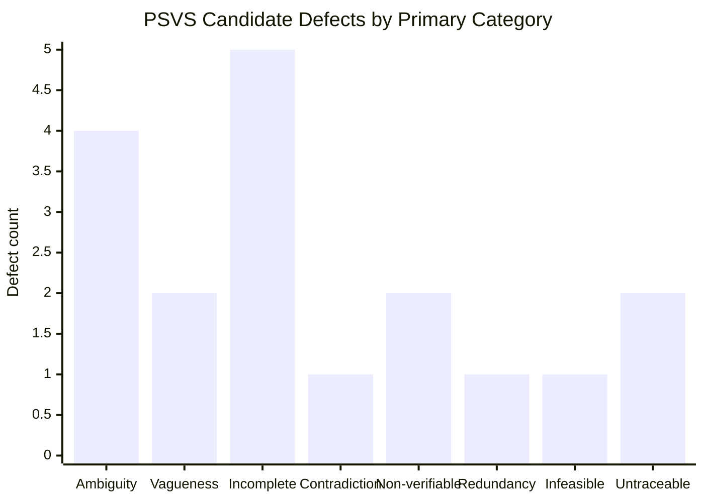

# Defect Analysis Summary — PSVS

> Counts below use one primary category per candidate defect in `defect-logs/defect-log.md`. Recalculate if you revise the log.

## Summary by Primary Category

| Category | Count | Percentage |
|---|---:|---:|
| Ambiguity | 4 | 22.22% |
| Vagueness | 2 | 11.11% |
| Incompleteness | 5 | 27.78% |
| Contradiction / potential contradiction | 1 | 5.56% |
| Non-verifiability | 2 | 11.11% |
| Redundancy | 1 | 5.56% |
| Infeasibility | 1 | 5.56% |
| Untraceability | 2 | 11.11% |
| **Total** | **18** | **100%** |

## Summary by Severity

| Severity | Count | Percentage |
|---|---:|---:|
| Critical | 2 | 11.11% |
| High | 7 | 38.89% |
| Medium | 8 | 44.44% |
| Low | 1 | 5.56% |
| **Total** | **18** | **100%** |

## Defect Category Chart

## Analysis
The largest category is incompleteness, with five findings. These findings indicate that several requirements omit operational rules needed for implementation and verification. Ambiguity is also prominent, particularly around registration, emergency release, and annual withdrawal quotas.

The two Critical findings concern emergency release authority and the temperature limit during maintenance. These findings need careful interpretation: they may be resolvable by defining explicit exceptions, authorization, and precedence rules rather than changing the underlying intent.

## Recommended Corrective Actions
1. Define emergency conditions and approval rules for release.
2. Define the maintenance exception to the temperature limit, including duration and recovery.
3. Define measurable viability thresholds and response times.
4. Define the annual quota denominator, calculation, and enforcement.
5. Specify audit-event fields, integrity, retention, and traceability.
6. Add objective acceptance criteria to make requirements verifiable.

## Limitations
This is an initial manual inspection. Validate category and severity assignments, remove duplicate findings, and update the report after actual peer review.
